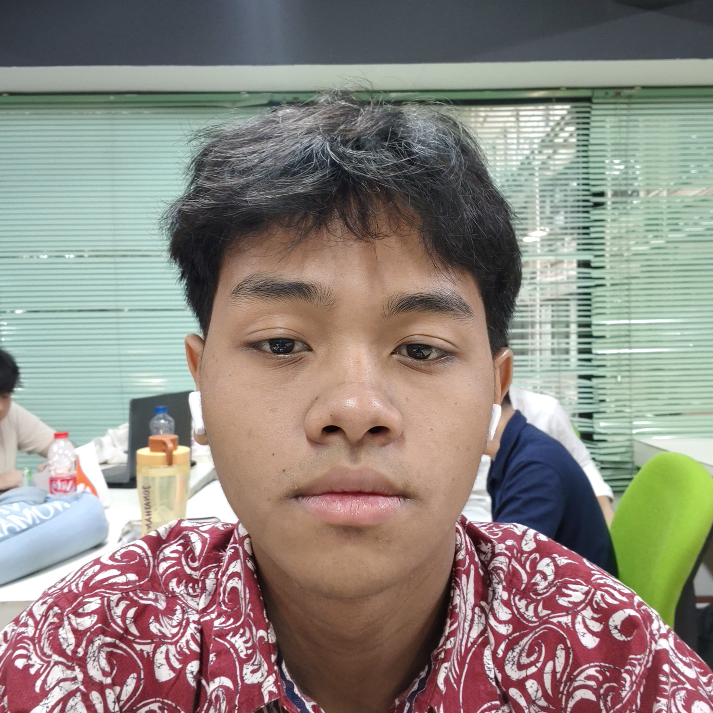
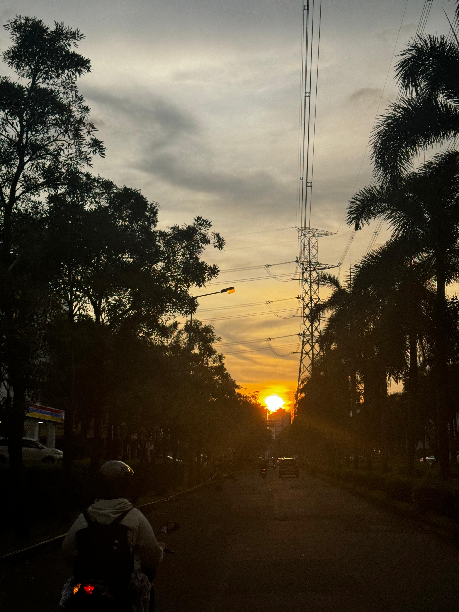
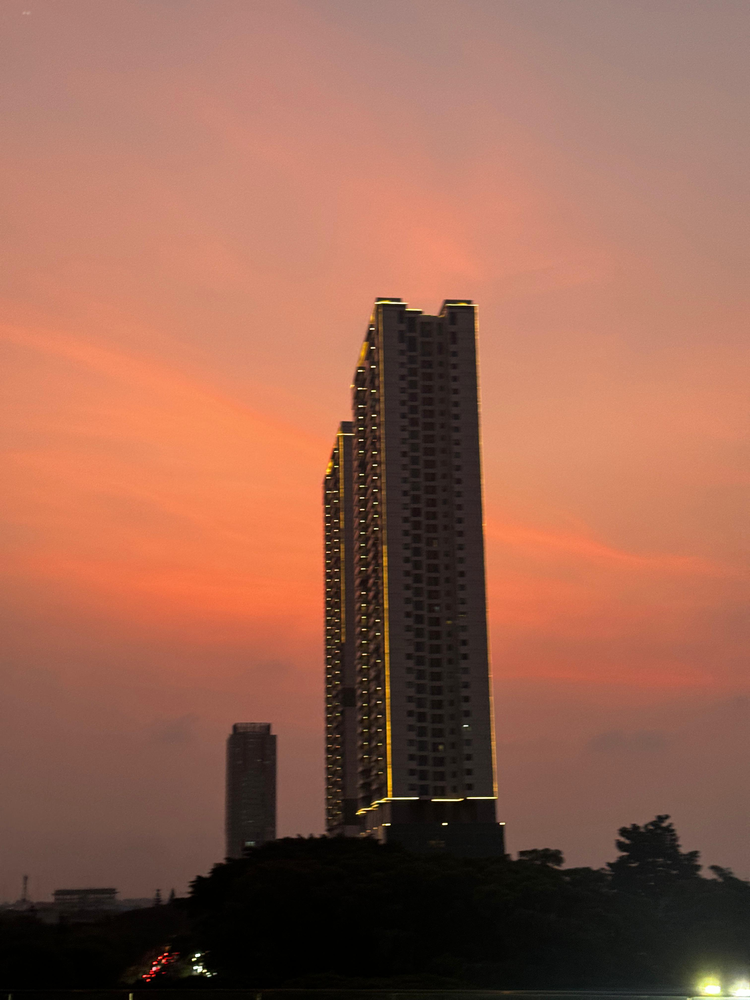
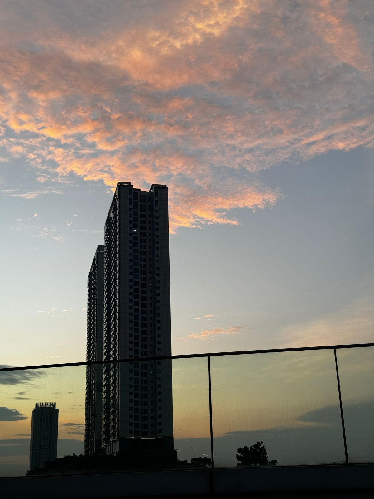
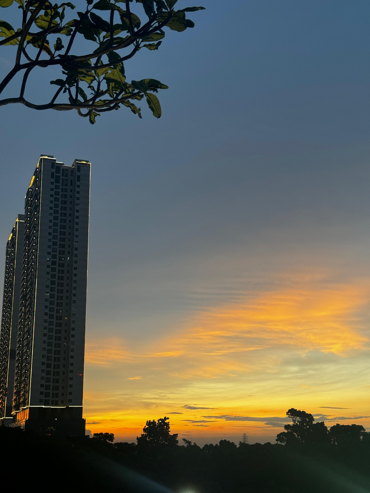
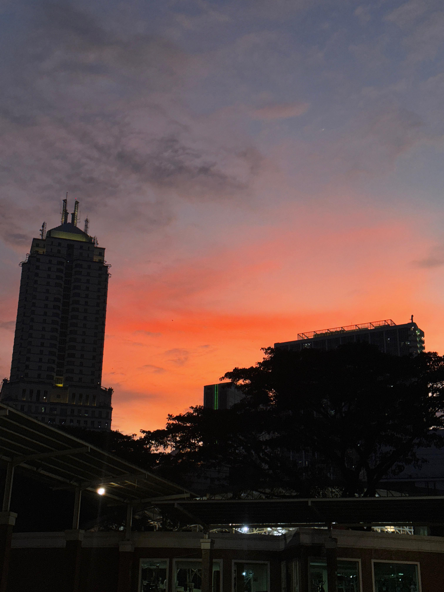

# magang — Website Portfolio Pribadi

Website portfolio pribadi statis yang dibuat dengan **Bootstrap 5**. Halaman ini berisi profil singkat, galeri foto, dan form kontak. Dipublikasikan otomatis ke **GitHub Pages** lewat GitHub Actions.

**Live site:** https://veryrareuser.github.io/magang/

## Isi Halaman

| Bagian | Isi |
| --- | --- |
| **Navbar** | Menu `Home`, `About`, `Projects`, `Contact` dengan efek *collapse* di layar kecil |
| **Jumbotron** | Foto profil berbentuk lingkaran, nama, dan tagline |
| **About** | Tiga kolom biodata singkat (asal, minat programming, hobi) |
| **Projects** | Grid kartu galeri foto sunset (5 kartu, layout 3 kolom) |
| **Contact** | Formulir nama, email, dan pesan |
| **Footer** | Credit dengan tautan ke profil GitHub |

## Fitur

- Navbar *fixed* dengan tombol hamburger untuk tampilan mobile.
- Pembatas antar-bagian memakai **SVG wave divider** (inline SVG, tanpa file gambar tambahan).
- Galeri foto dalam bentuk **Bootstrap Cards** yang menyesuaikan jumlah kolom di breakpoint `md`.
- Ikon navigasi dan tombol memakai **Bootstrap Icons 1.13**.
- Form kontak dengan validasi `required` bawaan Bootstrap dan *placeholder* berbahasa Indonesia.
- Tema warna konsisten: biru `#3674b5` dan biru muda `#a1e3f9`.
- Sepenuhnya responsif tanpa framework JavaScript tambahan.

## Tech Stack

| Lapisan | Teknologi |
| --- | --- |
| Markup | HTML5 |
| Styling | CSS3 (custom `style.css`) + Bootstrap 5.3.6 (CDN) |
| Ikon | Bootstrap Icons 1.13 (CDN) |
| Interactivity | Bootstrap 5.3.6 Bundle JS (CDN) |
| Deployment | GitHub Pages via GitHub Actions |

## Struktur Proyek

```
.
├── .github/
│   └── workflows/
│       └── static.yml     # Workflow deploy otomatis ke GitHub Pages
├── img/
│   ├── IMG-20250522-WA0004.jpg   # Foto profil (jumbotron)
│   ├── IMG-20250522-WA0005.jpg
│   ├── IMG-20250522-WA0006.jpg
│   ├── IMG-20250522-WA0007.jpg
│   └── projects/
│       ├── IMG-20250522-WA0060.jpg   # Sunset 1
│       ├── IMG-20250522-WA0061.jpg   # Sunset 2
│       ├── IMG-20250522-WA0062.jpg   # Sunset 3
│       ├── IMG-20250522-WA0063.jpg   # Sunset 4
│       └── IMG-20250522-WA0064.jpg   # Sunset 5
├── index.html
└── style.css
```

## Preview

Foto profil yang dipakai pada jumbotron:



Galeri proyek:

| Sunset 1 | Sunset 2 | Sunset 3 |
| --- | --- | --- |
|  |  |  |

| Sunset 4 | Sunset 5 |
| --- | --- |
|  |  |

## Menjalankan Secara Lokal

Tidak ada build step dan tidak ada dependensi yang perlu diinstal — cukup buka `index.html` di browser:

```bash
# Opsi 1: buka langsung
start index.html

# Opsi 2: jalankan server statis ringan
npx serve .
```

Lalu buka `http://localhost:3000`. Koneksi internet diperlukan karena Bootstrap dan Bootstrap Icons dimuat dari CDN.

## Deployment

Workflow `.github/workflows/static.yml` berjalan otomatis pada setiap push ke branch `main`:

1. Checkout repository.
2. Upload seluruh isi repository sebagai artifact Pages.
3. Deploy ke GitHub Pages dengan environment `github-pages`.

Status build dapat dilihat pada tab **Actions** di repository ini.

## Catatan

- Form kontak bersifat **statis** — belum tersambung ke backend atau layanan email, sehingga data yang diisi hanya terkirim ke browser.
- Seluruh aset gambar disimpan lokal di folder `img/`, bukan di CDN.
- Repository ini berisi sumber website statis; riwayat deploy dikelola GitHub Pages.
